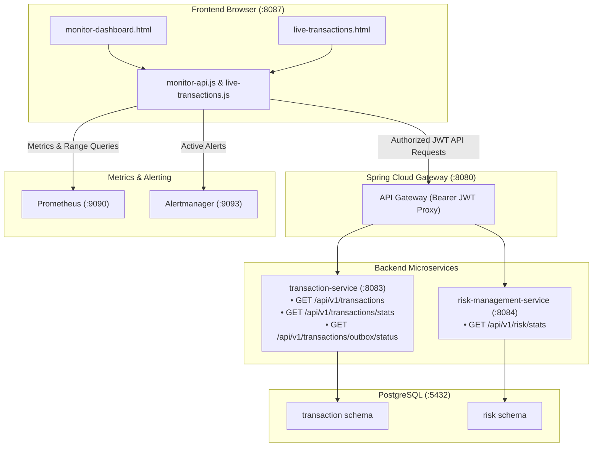

# Vigilia Platform — Monitoring Data Audit & Resolution

This document tracks the audit of telemetry, metrics, and data sources across the Vigilia monitoring workspace (`monitor-dashboard.html` and `live-transactions.html`).

---

## 🟢 Status by Page

### 1. Command Center (`monitor-dashboard.html`)
| Element / Card | Previous State | Current Status | Real Data Source |
|---|---|---|---|
| **Fleet Services Online** | Static `8/8` | **100% Dynamic** | Prometheus `fetchTargets()` & `up` metric |
| **Process CPU %** | Static | **100% Dynamic** | Prometheus `avg(process_cpu_usage) * 100` |
| **JVM Heap Memory** | Static | **100% Dynamic** | Prometheus `sum(jvm_memory_used_bytes)` |
| **Transaction Flow (TPS)** | Static | **100% Dynamic** | Prometheus `sum(rate(http_server_requests_seconds_count[5m]))` |
| **Fraud Decision Distribution** | Static SVG arcs & numbers | **100% Dynamic** | `GET /api/v1/risk/stats` (dynamic SVG arcs, 0 when empty) |
| **Transactional Outbox Status** | Fake Kafka partitions | **100% Dynamic** | `GET /api/v1/transactions/outbox/status` (live pending count, relay status) |
| **Channel Telemetry** | Fake mock throughput | **100% Dynamic** | `GET /api/v1/transactions/stats` |
| **Safeguards & Watchdogs** | Static alerts | **100% Dynamic** | Alertmanager `GET /api/v2/alerts` & Prometheus rules |

### 2. Live Transactions View (`live-transactions.html`)
| Element / Card | Previous State | Current Status | Real Data Source |
|---|---|---|---|
| **Transaction Feed Table** | 8 hardcoded mock rows (#82370...#82363) | **100% Dynamic** | `GET /api/v1/transactions` (empty state when 0 tx) |
| **Footer & Showing Counter** | "Showing 8 of 11,624" | **100% Dynamic** | Dynamic count from transaction API |
| **Throughput Timeline Wave** | Hardcoded static SVG wave & static X timestamps (`13:30`..`14:30`) | **100% Dynamic** | Prometheus range query via `monitor-api.js` (flat baseline when 0, dynamic timestamps) |
| **Timeline Range Switcher** | Inactive (1h, 24h, 7d) | **100% Dynamic** | Re-queries Prometheus for 1h (3600s), 24h (86400s), or 7d (604800s) |
| **AI Decision Breakdown Donut** | Static SVG arcs & 11,619 label | **100% Dynamic** | `GET /api/v1/risk/stats` |
| **Channel Performance Telemetry** | Fake volumes ($684.2K, $412.8K) and mock averages | **100% Dynamic** | `GET /api/v1/transactions/stats` (resets cleanly to $0 / 0.00 tx/s) |
| **AI Risk Score Confidence** | Static `80.4% Safe / 19.6% Flagged` | **100% Dynamic** | `GET /api/v1/risk/stats` (`approvedPct` / `pendingReviewPct + rejectedPct`) |
| **Risk Score Distribution Bars** | Static heights (65%, 38%, 25%, 18%) & fake percentages | **100% Dynamic** | `GET /api/v1/risk/stats` (`bucket0Pct`...`bucket3Pct`) |
| **Policy Enforcement Log** | Static counts | **100% Dynamic** | `GET /api/v1/risk/stats` rule breakdown |

---

## 🔧 Architecture & Data Flow

